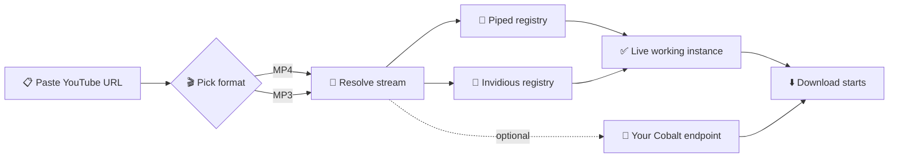

<div align="center">

# 🚀 HEXTube Downloader

### Grab it in one tap — YouTube, Instagram, TikTok, Facebook, Twitter, Pinterest.

**Video, audio, or full post. Ready.**

[](https://git.io/typing-svg)

<br/>

[](https://hexsleuth.github.io/HEXTube-Downloader/)
[](https://github.com/hexsleuth/HEXTube-Downloader/issues/new)
[](https://github.com/hexsleuth/HEXTube-Downloader/issues/new)

</div>

---

<div align="center">

## 📊 Realtime Project Badges

<!-- GitHub Stats -->
[](https://github.com/HexSleuth/HEXTube-Downloader/stargazers)
[](https://github.com/HexSleuth/HEXTube-Downloader/network/members)
[](https://github.com/HexSleuth/HEXTube-Downloader/issues)
[](https://github.com/HexSleuth/HEXTube-Downloader/pulls)

<!-- Commit & Release -->
[](https://github.com/HexSleuth/HEXTube-Downloader/commits/main)
[](https://github.com/HexSleuth/HEXTube-Downloader/releases)
[](https://github.com/HexSleuth/HEXTube-Downloader/blob/main/LICENSE)

<!-- Deployment & Status -->
[](https://hexsleuth.github.io/HEXTube-Downloader/)
[](https://github.com/HexSleuth/HEXTube-Downloader/actions)

<!-- Repo Size & Tech -->
[](https://github.com/HexSleuth/HEXTube-Downloader)
[](https://developer.mozilla.org/en-US/docs/Web/HTML)
[](https://developer.mozilla.org/en-US/docs/Web/CSS)
[](https://developer.mozilla.org/en-US/docs/Web/JavaScript)

</div>

---

## ✨ About HEXTube

**HEXTube** is a **single-page, zero-install YouTube downloader front-end**.  
Drop a link, choose **MP4** or **MP3**, and grab your file — served through live-fetched **Piped** and **Invidious** instances, with optional **Cobalt** support.

> **No accounts. No tracking. No build step.** [reference:2]

---

## 🎯 Key Features

| Feature | Description |
|---------|-------------|
| **One-box workflow** | Paste → pick format → download. That's it. |
| **MP4 & MP3** | Video with audio, or audio-only extraction. |
| **Live instance discovery** | Piped & Invidious lists fetched from official registries at download time — always working servers. |
| **Cobalt (optional)** | Bring your own endpoint via Settings for a third fallback. |
| **Realtime progress** | Live percentage, status line and error surfaces. |
| **33 DaisyUI themes** | Corporate → Cyberpunk → Abyss → Silk. |
| **Dark mode force-locked** | Themes only recolor accents + dark surface tint. Never light mode. |
| **No backend, no logs** | Static site. Your links never touch our servers. |
| **Zero dependencies to install** | Pure static HTML/CSS/JS on GitHub Pages. |

> Source: Official feature table [reference:3]

---

## 📱 Mobile-First by Design

| Feature | How it behaves |
|---------|----------------|
| **Fluid layout** | Single column → adapts from 320 px phones to 4K desktops. |
| **Thumb-friendly** | 44 px+ tap targets on every control. |
| **No horizontal scroll** | Badges, tables and code wrap or scroll internally. |
| **Sticky status bar** | Progress + percentage always in reach on small screens. |
| **One-tap themes** | 33 DaisyUI themes in a scrollable chip grid. |
| **Reduced motion** | Animated effects respect `prefers-reduced-motion`. |

> Source: Mobile-first design table [reference:4]

---

## ⚙️ How It Works



Flowchart source: Repository README 

---

🚀 Download Engines

Engine Source of truth Auto Notes
Piped Official Piped registry ✅ Tried first
Invidious Official Invidious registry ✅ Automatic fallback
Cobalt Your own endpoint ⚙️ Configure in Settings

Instance lists are pulled at download time, not cached at build time — so you always hit a server that's currently alive. 

---

🎨 Themes (33 DaisyUI Themes)

<div align="center">

🌑 Dark 🌈 Vibrant 🍂 Nature ✨ Special
Corporate Cupcake Emerald Synthwave
Bumblebee Retro Cyberpunk Valentine
Halloween Garden Forest Aqua
Lofi Pastel Fantasy Wireframe
Black Luxury Dracula CMYK
Autumn Business Acid Lemonade
Night Coffee Winter Dim
Nord Sunset Caramel Latte Abyss
Silk   

</div>

Dark mode is force-locked by •HexSleuth• — themes only recolor accents and the dark surface tint, so the interface can never fall back to light mode. 

---

📈 Project Pulse

<div align="center">

https://github-readme-activity-graph.vercel.app/graph?username=hexsleuth&repo=HEXTube-Downloader&bg_color=0D1117&color=00E5FF&line=7B2FF7&point=FF2E88&area=true&hide_border=true

</div>

---

⭐ Star History

<div align="center">

https://api.star-history.com/svg?repos=hexsleuth/HEXTube-Downloader&type=Date&theme=dark

</div>

---

⚡ Quick Start

Use it now

👉 hexsleuth.github.io/HEXTube-Downloader — nothing to install.

Run it locally

```bash
# 1. Clone
git clone https://github.com/hexsleuth/HEXTube-Downloader.git
cd HEXTube-Downloader

# 2. Serve (any static server works)
python -m http.server 8080
# or: npx serve .

# 3. Open
# http://localhost:8080
```

Deploy your own copy

```
Fork → Settings → Pages → Deploy from branch → main / (root)
Done. Your fork is live at https://<your-username>.github.io/HEXTube-Downloader/
```

Quick start instructions from the official repository 

---

📖 Usage

1. Paste any YouTube URL (watch?v=, youtu.be/, shorts/).
2. Choose MP4 for video or MP3 for audio.
3. Hit Download — HEXTube resolves a live Piped/Invidious instance automatically.
4. (Optional) Open Settings → add your own Cobalt endpoint as a third engine.
5. (Optional) Pick a theme from the chip grid — dark mode stays locked.

Usage steps from the repository 

---

🗺️ Roadmap

☑ Paste → MP4 / MP3 → download flow
☑ Live Piped + Invidious registry resolution
☑ Optional Cobalt endpoint
☑ 33 DaisyUI themes + force-locked dark mode
☑ Realtime progress & error states
☑ Mobile-first responsive layout
☐ Playlist / batch downloads
☐ Subtitle & thumbnail export
☐ PWA install + offline shell
☐ i18n (multi-language UI)

Roadmap from the official README 

---

❓ FAQ

<details>
<summary><b>Is anything uploaded to a server?</b></summary>
No. HEXTube is a static site — your URL is resolved client-side against public Piped / Invidious instances. Nothing is logged by this project.
</details>

<details>
<summary><b>Why do downloads sometimes fail?</b></summary>
Public Piped/Invidious instances go up and down constantly. HEXTube re-fetches the live registry on every download and retries across instances, but if <i>all</i> public instances are down, the request can still fail. Add your own <b>Cobalt</b> endpoint in Settings for maximum reliability.
</details>

<details>
<summary><b>Why can't I switch to light mode?</b></summary>
By design. Dark mode is force-locked — themes recolor accents and the dark surface tint only.
</details>

<details>
<summary><b>Can I self-host it?</b></summary>
Yes — it's plain static files. Any host (GitHub Pages, Netlify, Vercel, nginx, a USB stick) works.
</details>

<details>
<summary><b>Does it work on mobile?</b></summary>
Yes. The interface is mobile-first: fluid layout, thumb-friendly controls, no horizontal scroll, and a sticky progress bar.
</details>

FAQ content from the repository 

---

🤝 Contributing

Contributions are what keep this alive.

1. Fork the repo.
2. Create a branch: git checkout -b feat/your-idea
3. Commit: git commit -m "feat: add your idea"
4. Push & open a PR: git push origin feat/your-idea

Please keep the project static, dependency-free at runtime, and dark-mode locked.

<div align="center">

https://contrib.rocks/image?repo=hexsleuth/HEXTube-Downloader

</div>

Contributing guidelines from the repository 

---

⚠️ Disclaimer

HEXTube is a front-end only utility for personal, educational use. It hosts no media and stores no files.

Respect YouTube's Terms of Service and the copyright of content owners — only download content you own or that is licensed for reuse.

Disclaimer from the repository 

---

📄 License

Distributed under the MIT License — see LICENSE.

---

<div align="center">

Crafted with ❤️ by •HexSleuth•

https://img.shields.io/github/followers/hexsleuth?style=for-the-badge&logo=github&color=00E5FF
https://img.shields.io/badge/Sponsor-FF2E88?style=for-the-badge&logo=githubsponsors&logoColor=white

</div>
