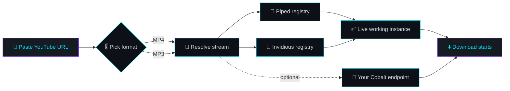

<div align="center">
  
<!-- ═══════════════════════════════════════════════════════════════════════
     HEXTube — GitHub README
     Repo: hexsleuth/HEXTube-Downloader
     Live: https://hexsleuth.github.io/HEXTube-Downloader/
     ═══════════════════════════════════════════════════════════════════════ -->


<!-- ══════════════ ANIMATED HEADER ══════════════ -->


<!-- ══════════════ TYPING ANIMATION ══════════════ -->

<a href="https://hexsleuth.github.io/HEXTube-Downloader/">
  
</a>

<br/>

<!-- ══════════════ REALTIME BADGES · ROW 1 ══════════════ -->

[](https://hexsleuth.github.io/HEXTube-Downloader/)
[](https://github.com/hexsleuth/HEXTube-Downloader/stargazers)
[](https://github.com/hexsleuth/HEXTube-Downloader/forks)
[](https://github.com/hexsleuth/HEXTube-Downloader/watchers)

<!-- ══════════════ REALTIME BADGES · ROW 2 ══════════════ -->

[](https://github.com/hexsleuth/HEXTube-Downloader/issues)
[](https://github.com/hexsleuth/HEXTube-Downloader/pulls)
[](https://github.com/hexsleuth/HEXTube-Downloader/commits)
[](https://github.com/hexsleuth/HEXTube-Downloader/graphs/commit-activity)

<!-- ══════════════ REALTIME BADGES · ROW 3 ══════════════ -->

[](https://github.com/hexsleuth/HEXTube-Downloader/releases)
[](https://github.com/hexsleuth/HEXTube-Downloader/graphs/contributors)
[](https://github.com/hexsleuth/HEXTube-Downloader)
[](https://github.com/hexsleuth/HEXTube-Downloader)

<!-- ══════════════ STACK BADGES ══════════════ -->


<br/>

<!-- ══════════════ CTA BUTTON ══════════════ -->

<a href="https://hexsleuth.github.io/HEXTube-Downloader/">
  
</a>
<a href="https://github.com/hexsleuth/HEXTube-Downloader/issues/new">
  
</a>
<a href="https://github.com/hexsleuth/HEXTube-Downloader/fork">
  
</a>

<br/><br/>


</div>

<br/>

> **HEXTube** is a **single-page**, **zero-install** YouTube downloader front-end. Drop a link, choose **MP4** or **MP3**, and grab your file — served through **live-fetched Piped** and **Invidious** instances, with optional **Cobalt** support. No accounts. No tracking. No build step.

<div align="center">

### ⚡ [Live Demo](https://hexsleuth.github.io/HEXTube-Downloader/) ⚡

</div>

---

## 📱 Mobile-First, Desktop-Ready

<div align="center">

| 💎 Feature | 📐 Behaviour |
| :--- | :--- |
| **Fluid single-column layout** | Scales from 320 px phones → 4K desktops |
| **Thumb-friendly targets** | Every button ≥ 44 px tap area |
| **No horizontal scroll** | Badges wrap, tables scroll internally |
| **Sticky status bar** | Progress % always visible on small screens |
| **One-tap themes** | 33 DaisyUI themes in a scrollable chip grid |
| **Reduced-motion aware** | Animations respect `prefers-reduced-motion` |

</div>

---

## ✨ Feature Matrix

<div align="center">

| | Feature | Description |
| :---: | :--- | :--- |
| 🎯 | **One-box workflow** | Paste → pick format → download. Three steps. |
| 🎬 | **MP4 & MP3** | Video with audio, or audio-only extraction. |
| 📡 | **Live instance discovery** | Piped & Invidious lists fetched from official registries at download time — always-working servers. |
| 🧩 | **Cobalt (optional)** | Bring your own endpoint via Settings for a third fallback. |
| 📊 | **Realtime progress** | Live percentage, status line, and error surface. |
| 🎨 | **33 DaisyUI themes** | Corporate → Cyberpunk → Abyss → Silk. |
| 🌑 | **Dark mode force-locked** | Themes only recolor accents + dark surface tint. Never light mode. |
| 🔒 | **No backend, no logs** | Static site. Your links never touch our servers. |
| 🪶 | **Zero install** | Pure static HTML/CSS/JS on GitHub Pages. |

</div>

---

## 🚀 How It Works



<div align="center">

UI Flow Preview

```
┌──────────────────────────────────────────────────────────┐
│  https://youtu.be/…                              [Paste] │
├──────────────────────────────────────────────────────────┤
│  ( ) MP4   (•) MP3                        [ Download ]   │
├──────────────────────────────────────────────────────────┤
│  ▓▓▓▓▓▓▓▓▓▓▓▓▓▓▓▓▓▓▓▓▓▓▓▓░░░░░░░░░░░░░░░░░  64%          │
│  Fetching live Invidious instances…                      │
└──────────────────────────────────────────────────────────┘
```

</div>

---

🛰️ Download Engines

<div align="center">

Engine Source of Truth Auto Notes
Piped Official Piped registry ✅ Tried first
Invidious Official Invidious registry ✅ Automatic fallback
Cobalt Your own endpoint ⚙️ Configure in Settings

</div>

🔄 Instance lists are pulled at download time, not cached at build time — so you always hit a server that's currently alive.

---

🎨 Themes

33 DaisyUI themes. Dark mode is force-locked by 𓋹•HexSleuth•𓃠 — themes only recolor accents and the dark surface tint, so the interface can never fall back to light mode.

<details>
<summary><b>🎛️ Click to expand full theme list</b></summary>

<br/>

<div align="center">

corporate · cupcake · bumblebee · emerald · synthwave · retro · cyberpunk · valentine · halloween · garden · forest · aqua · lofi · pastel · fantasy · wireframe · black · luxury · dracula · cmyk · autumn · business · acid · lemonade · night · coffee · winter · dim · nord · sunset · caramellatte · abyss · silk

</div>

</details>

---

⚡ Quick Start

🌐 Use it now (nothing to install)

👉 hexsleuth.github.io/HEXTube-Downloader

🖥️ Run it locally

```bash
# 1. Clone
git clone https://github.com/hexsleuth/HEXTube-Downloader.git
cd HEXTube-Downloader

# 2. Serve (any static server works)
python -m http.server 8080
#    or: npx serve .

# 3. Open
#    http://localhost:8080
```

🚀 Deploy your own copy

```bash
# Fork → Settings → Pages → Deploy from branch → main / (root)
# Done. Your fork is live at:
# https://<your-username>.github.io/HEXTube-Downloader/
```

---

🧭 Usage

1. Paste any YouTube URL (watch?v=, youtu.be/, shorts/).
2. Choose MP4 for video or MP3 for audio-only.
3. Hit Download — HEXTube resolves a live Piped/Invidious instance automatically.
4. (Optional) Open Settings → add your own Cobalt endpoint as a third engine.
5. (Optional) Pick a theme from the chip grid — dark mode stays locked.

---

📊 Project Pulse

<div align="center">


https://github-readme-activity-graph.vercel.app/graph?username=hexsleuth&repo=HEXTube-Downloader&bg_color=0D1117&color=00E5FF&line=7B2FF7&point=FF2E88&area=true&hide_border=true

</div>

---

🗺️ Roadmap

☑ Paste → MP4 / MP3 → download flow
☑ Live Piped + Invidious registry resolution
☑ Optional Cobalt endpoint
☑ 33 DaisyUI themes + force-locked dark mode
☑ Realtime progress & error states
☑ Mobile-first responsive layout
☐ Playlist / batch downloads
☐ Subtitle & thumbnail export
☐ PWA install + offline shell
☐ i18n (multi-language UI)

---

❓ FAQ

<details>
<summary><b>🔒 Is anything uploaded to a server?</b></summary>
<br/>
No. HEXTube is a static site — your URL is resolved client-side against public Piped / Invidious instances. Nothing is logged by this project.
</details>

<details>
<summary><b>⚠️ Why do downloads sometimes fail?</b></summary>
<br/>
Public Piped/Invidious instances go up and down constantly. HEXTube re-fetches the live registry on every download and retries across instances, but if <i>all</i> public instances are down, the request can still fail. Add your own <b>Cobalt</b> endpoint in Settings for maximum reliability.
</details>

<details>
<summary><b>🌑 Why can't I switch to light mode?</b></summary>
<br/>
By design. Dark mode is force-locked — themes recolor accents and the dark surface tint only.
</details>

<details>
<summary><b>🏠 Can I self-host it?</b></summary>
<br/>
Yes — it's plain static files. Any host (GitHub Pages, Netlify, Vercel, nginx, a USB stick) works.
</details>

<details>
<summary><b>📱 Does it work on mobile?</b></summary>
<br/>
Yes. The interface is mobile-first: fluid layout, thumb-friendly controls, no horizontal scroll, and a sticky progress bar.
</details>

<details>
<summary><b>🎬 Does it support Shorts or music.youtube.com?</b></summary>
<br/>
Any standard YouTube URL form works — including <code>youtu.be/</code>, <code>/watch?v=</code>, and <code>/shorts/</code>. Just paste and let the resolver pick the stream.
</details>

---

🤝 Contributing

Contributions keep this alive.

```bash
# 1. Fork the repo
# 2. Create a branch
git checkout -b feat/your-idea

# 3. Commit
git commit -m "feat: add your idea"

# 4. Push & open a PR
git push origin feat/your-idea
```

Please keep the project static, dependency-free at runtime, and dark-mode locked. 🖤

<div align="center">

https://contrib.rocks/image?repo=hexsleuth/HEXTube-Downloader

</div>

---

⚠️ Disclaimer

HEXTube is a front-end-only utility for personal, educational use. It hosts no media and stores no files. Respect YouTube's Terms of Service and the copyright of content owners — only download content you own or that is licensed for reuse.

---

📄 License

Distributed under the MIT License — see LICENSE.

---

<div align="center">

⭐ Star History

https://api.star-history.com/svg?repos=hexsleuth/HEXTube-Downloader&type=Date&theme=dark

<br/>

<a href="https://hexsleuth.github.io/HEXTube-Downloader/">
  
</a>

<br/>

Crafted with 🖤 by 𓋹•HexSleuth•𓃠


</div>
